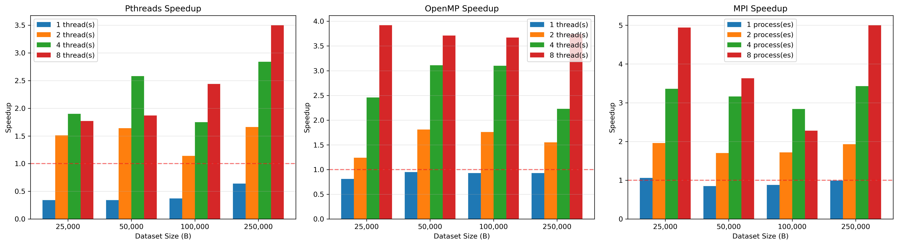
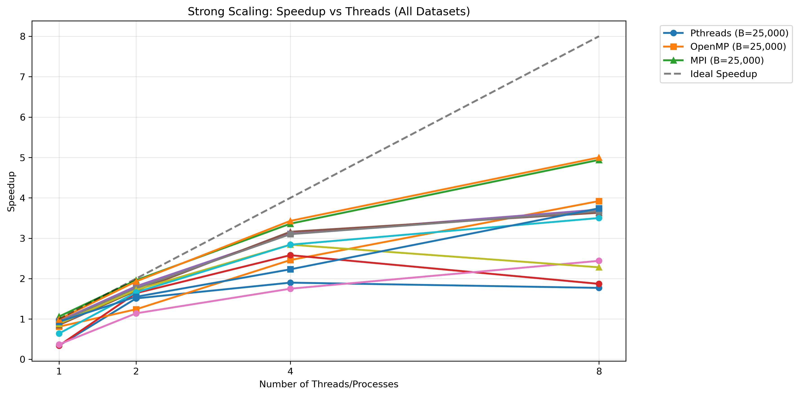

# Parallel Token Verification Engine for Speculative Decoding in LLMs

**Author:** Minahil Imran (2023-CS-134) — Parallel & Distributed Computing Lab Project

## Overview

This project implements a parallel token verification engine for speculative decoding in Large Language Models (LLMs). Instead of verifying a single draft sequence, the engine verifies **B candidate sequences of K tokens each** per round, using the acceptance rule from Chen et al. (2023). A sequential baseline is accelerated with three parallel implementations: **Pthreads**, **OpenMP** and **MPI**.

The full write-up is in [`docs/paper.pdf`](docs/paper.pdf), with the Gantt chart and experimental logbook in [`docs/appendices.pdf`](docs/appendices.pdf).

## Algorithm

- **Draft model:** `distilgpt2` (generates candidate tokens and their log-probabilities `log q`)
- **Target model:** `gpt2` (scores the same tokens, giving `log p`)
- **Acceptance rule:** accept a token if `u < min(1, p_target / p_draft)`, where `u ~ Uniform(0,1)`; verification of a candidate stops at its first rejected token
- **Winner selection:** the candidate with the longest accepted prefix; ties are broken by the highest cumulative target log-probability
- **Commit rule:** rollback-free — the winner's accepted prefix is appended to the context

The model inference is done offline (see [Test Data](#test-data)); the C programs only perform the verification step, which is `B × K` independent acceptance tests per round — an embarrassingly parallel workload.

## Parallel Implementations

| Version    | Decomposition                          | Synchronization / Communication |
|------------|----------------------------------------|---------------------------------|
| Pthreads   | Contiguous block of candidates per thread | Mutex-protected global winner; main thread aggregates statistics |
| OpenMP     | `#pragma omp for` over candidates       | `reduction` for statistics, `critical` section for the winner |
| MPI        | Block partitioning of candidates across ranks | `MPI_Reduce` (sum) for statistics, `MPI_Gather` of local winners to rank 0 |

Each verification round is repeated 50 times (`BENCHMARK_REPEAT`) and the average time is reported.

## Project Structure

```
.
├── src/
│   ├── sequential/main_seq.c    # Sequential baseline
│   ├── pthreads/main_pth.c      # Pthreads version
│   ├── openmp/main_omp.c        # OpenMP version
│   └── mpi/main_mpi.c           # MPI version
├── data/
│   ├── gpt2_vocab.txt           # GPT-2 vocabulary (id<TAB>token), used to print text
│   ├── data_generator.ipynb     # Generates rounds_<B>.bin with distilgpt2 + gpt2
│   └── rounds_*.bin             # Datasets (not in the repo; see Test Data)
├── scripts/run_experiments.sh   # Compiles and runs all versions / configurations
├── results/
│   ├── summary_results.csv      # Measured timings and speedups
│   ├── generate_graphs.py       # Speedup / strong-scaling plots
│   ├── generate_gantt.py        # Project Gantt chart
│   └── *.png                    # Generated figures
├── paper/                       # LaTeX sources (paper, appendices, logbook)
├── docs/                        # Compiled paper and appendices (PDF)
└── literature_review/           # Literature review
```

## Dependencies

- **GCC** 9.0+ (with OpenMP support)
- **OpenMPI** 4.0+ (`mpicc`, `mpirun`)
- **Linux** (developed and tested on Linux, x86_64)

Optional:
- **Python 3.8+** with `matplotlib` and `numpy` — to regenerate the graphs
- **PyTorch** and **Transformers** — to regenerate the datasets (the notebook was run on Google Colab)

## Test Data

Each `rounds_<B>.bin` file holds 5 rounds of `B` candidates with `K = 8` tokens, generated from the prompt *"Artificial intelligence is"*. Binary layout (little-endian):

```
int32 n_rounds, B, K, prompt_len
int32 prompt[prompt_len]
per round: int32 round_id, then B*K × { int32 token_id, float32 log_q, float32 log_p }
```

The datasets used in the experiments are B = 25,000, 50,000, 100,000 and 250,000 (≈12 MB – 120 MB each). **They are too large for GitHub and are not included in this repository.** To regenerate them, open [`data/data_generator.ipynb`](data/data_generator.ipynb) (e.g. in Google Colab), set `DATASETS = [25000, 50000, 100000, 250000]`, run it, and place the resulting `.bin` files in `data/`.

## Compilation

```bash
gcc   -O3 src/sequential/main_seq.c -o src/sequential/main_seq -lm
gcc   -O3 src/pthreads/main_pth.c   -o src/pthreads/main_pth   -lm -pthread
gcc   -O3 src/openmp/main_omp.c     -o src/openmp/main_omp     -lm -fopenmp
mpicc -O3 src/mpi/main_mpi.c        -o src/mpi/main_mpi        -lm
```

## Running

All programs take the rounds file and the vocabulary file as arguments (defaults: `rounds.bin` and `gpt2_vocab.txt` in the current directory). The Pthreads and OpenMP versions take the thread count as a third argument (default 4).

```bash
# Sequential baseline
./src/sequential/main_seq data/rounds_25000.bin data/gpt2_vocab.txt

# Pthreads (4 threads)
./src/pthreads/main_pth data/rounds_25000.bin data/gpt2_vocab.txt 4

# OpenMP (4 threads)
./src/openmp/main_omp data/rounds_25000.bin data/gpt2_vocab.txt 4

# MPI (4 processes; add --oversubscribe for more processes than cores)
mpirun -np 4 ./src/mpi/main_mpi data/rounds_25000.bin data/gpt2_vocab.txt
```

If the vocabulary file is missing, the programs still run but cannot print the decoded text.

## Automated Experiments

```bash
bash scripts/run_experiments.sh
```

The script:
1. Compiles all four versions
2. Runs the sequential baseline on all four datasets
3. Runs Pthreads, OpenMP and MPI with 1, 2, 4 and 8 threads/processes on all four datasets (MPI uses `--oversubscribe` for 8 processes)
4. Saves every run's output to `results/raw_outputs/`

To regenerate the figures from the results:

```bash
cd results
python3 generate_graphs.py   # speedup_comparison.png, strong_scaling.png, strong_scaling_all.png
python3 generate_gantt.py    # gantt_chart.png
```

## Output Format

Each program prints:
- Configuration (models, acceptance/winner/commit rules, thread or process count, R/B/K)
- Per round: tokens accepted, average accepted per candidate, fully accepted candidates, average verification time
- The winning candidate's tokens with `log q`, `log p` and acceptance ratio
- The context after each round
- A summary: total/committed/rejected tokens, total verification time, time per candidate and the generated text

## Results

Test system: Intel Core i7-6700HQ @ 2.60 GHz (4 physical cores, 8 hardware threads), 16 GB RAM, Linux, GCC with `-O3`, OpenMPI.

Speedup over the sequential baseline with 8 threads/processes (full data in [`results/summary_results.csv`](results/summary_results.csv)):

| Dataset (B) | Sequential time | Pthreads | OpenMP | MPI   |
|-------------|-----------------|----------|--------|-------|
| 25,000      | 0.0130 s        | 1.77×    | 3.92×  | 4.94× |
| 50,000      | 0.0264 s        | 1.87×    | 3.71×  | 3.63× |
| 100,000     | 0.0504 s        | 2.44×    | 3.67×  | 2.28× |
| 250,000     | 0.1308 s        | 3.50×    | 3.74×  | 5.00× |




Observations:
- MPI reaches the highest speedup (5.00× on B = 250,000 with 8 processes).
- OpenMP is the most consistent (≈3.7–3.9× with 8 threads on every dataset).
- Pthreads has noticeable overhead on small datasets (1 thread is slower than sequential) but scales to 3.50× on the largest one.
- Beyond 4 threads/processes the gains shrink, since the machine has only 4 physical cores (8 is hyper-threading).

## Complexity

- **Time:** O(R × B × K) sequential; O(R × (B/P) × K) for Pthreads/OpenMP; O(R × (B/P) × K) plus communication cost for MPI, where R = rounds and P = threads/processes
- **Space:** O(R × B × K) for the token data plus O(V) for the vocabulary (V = 50,257 for GPT-2)

## Notes on Reproducibility

All versions use the same xorshift64 RNG seed, but the parallel versions give each thread/rank its own RNG stream. This means acceptance decisions — and therefore the committed text — can differ from the sequential run and between thread counts. The timing comparison is unaffected because every version performs the same amount of work.

## Troubleshooting

- **`mpirun` not found / MPI errors:** install OpenMPI with `sudo apt-get install openmpi-bin libopenmpi-dev` and check `mpirun --version`.
- **"not enough slots" with MPI:** add `--oversubscribe`, e.g. `mpirun --oversubscribe -np 8 ...`.
- **`Error: cannot open ...`:** check the path to the `.bin` file (see [Test Data](#test-data)).
- **`-fopenmp` not recognized:** use a GCC build with OpenMP support (`gcc --version`, 9.0+).

## References

1. C. Chen et al., "Accelerating Large Language Model Decoding with Speculative Sampling," arXiv:2302.01318, 2023.
2. Y. Leviathan, M. Kalman, and Y. Matias, "Fast Inference from Transformers via Speculative Decoding," ICML, 2023.
